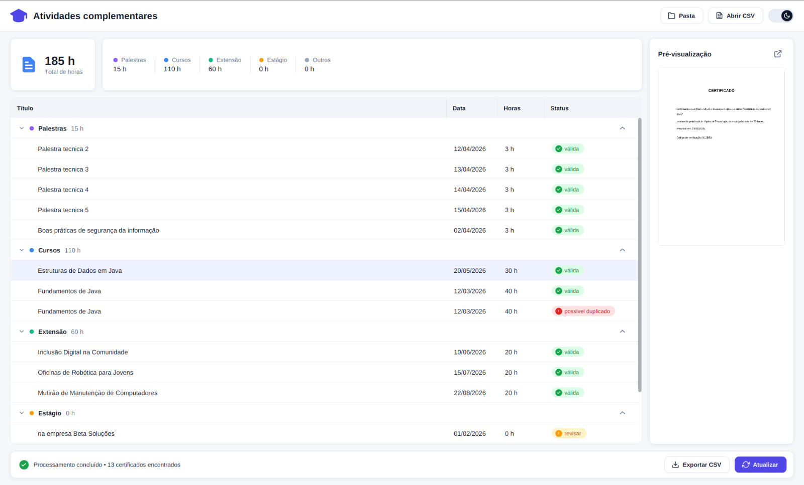
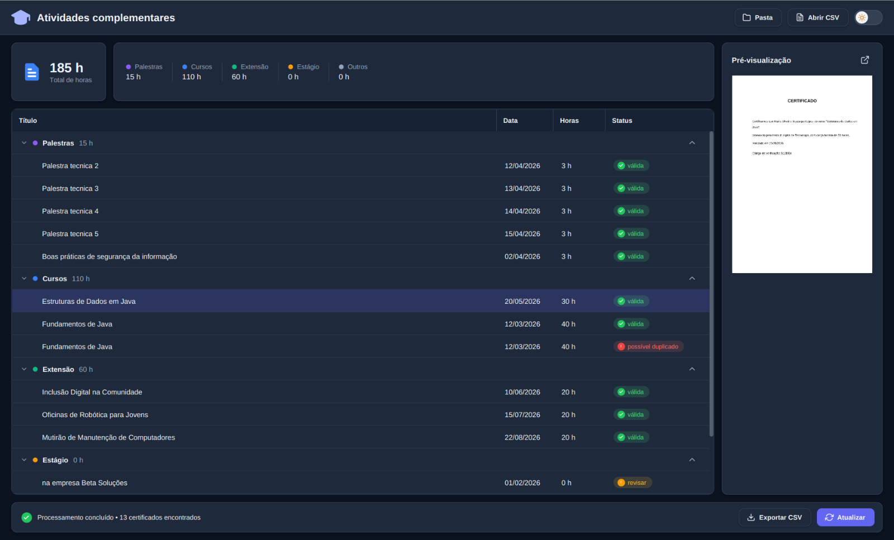

# Sistema de Análise de Certificados

Programa de desktop que ajuda estudantes a controlar as horas de atividades complementares da faculdade a partir dos certificados em PDF. É uma ferramenta simples, local e sem IA: você escolhe uma pasta com os certificados, o programa lê os arquivos, extrai os dados automaticamente e organiza tudo por categoria, com os totais de horas já calculados.

## Funcionalidades

- Leitura de PDFs de uma pasta escolhida pelo usuário.
- Extração automática de título, emissor, data, carga horária, código de verificação e participante.
- Classificação por categoria (Curso, Palestra, Extensão, Estágio, Monitoria, Outros) usando palavras-chave configuráveis.
- Soma das horas por item, por categoria e no total geral.
- Detecção de certificados duplicados (exatos e possíveis).
- Pré-visualização da primeira página do certificado selecionado.
- Sinalização de certificados que precisam de revisão (sem texto extraível ou campos faltando).
- Exportação e abertura de CSV (compatível com Excel em português).
- Interface moderna e minimalista, com tema claro e escuro (tema [AtlantaFX](https://github.com/mkpaz/atlantafx)).

## O que o programa NÃO faz

- Não valida a autenticidade de um certificado: ele extrai os dados e guarda o código de verificação (quando existe) para você conferir manualmente no site do emissor.
- Não aplica regras de nenhuma instituição (limite de horas por categoria, máximo por item etc.): ele mostra as horas que constam nos certificados, e a conferência com o regulamento do seu curso é sua.
- Não faz OCR: um PDF sem texto (por exemplo, uma imagem escaneada) fica com status "revisar".
- Sem nuvem, sem login, sem banco de dados e sem IA. Tudo roda localmente, usando arquivos.

## Como rodar a partir do código-fonte

Pré-requisitos: JDK 25 (ou mais recente) e Maven.

```bash
mvn clean javafx:run
```

Para rodar os testes automatizados do núcleo:

```bash
mvn test
```

## Como usar

1. Clique em **Pasta** e escolha a pasta com os certificados em PDF.
2. O programa lê os arquivos e organiza tudo na tabela, agrupado por categoria, com o total de horas de cada uma e o total geral.
3. Clique em um certificado para ver a pré-visualização da primeira página ao lado.
4. Dê duplo clique em um item para marcá-lo como ignorado (ele some da soma de horas).
5. Se um certificado caiu na categoria errada, arraste-o para a categoria certa. A mudança fica salva.
6. Para corrigir título, data, horas ou qualquer outro dado, selecione o certificado e clique em **Editar** (ou use o botão direito do mouse sobre ele).
7. Use **Exportar CSV** para salvar os dados numa planilha.
8. O botão no canto superior direito alterna entre tema claro e escuro.

Os certificados de exemplo na pasta [`exemplos/`](exemplos) são **fictícios**, só para teste.

## Capturas de tela

Tela principal no tema claro:



Tela principal no tema escuro:



## Arquitetura

O código é dividido em dois pacotes:

- `nucleo`: modelo de dados, leitura de PDF, extração de campos, classificação, cálculo de horas, detecção de duplicados e arquivos (CSV e configurações). Não depende do JavaFX, para poder ser testado sem abrir janela.
- `ui`: interface gráfica em JavaFX.

Os dados do usuário (certificados lidos, categorias, tema e última pasta) ficam em `~/.atividades-complementares/`, fora do repositório.

## Instalação (sem precisar instalar Java)

Instaladores prontos (Windows, Linux e macOS), com o Java já embutido, estão disponíveis na aba [Releases](../../releases) deste repositório, gerados automaticamente pelo GitHub Actions a cada nova versão.

No Windows, o instalador não é assinado digitalmente, então o SmartScreen pode avisar que o aplicativo é de "editor desconhecido". Isso é esperado: clique em "Mais informações" e depois em "Executar assim mesmo" para prosseguir.

## Gerando o instalador localmente

```bash
./scripts/empacotar.sh
```

O script compila o projeto com Maven e usa o `jpackage` (incluso no JDK) para gerar o instalador do seu sistema operacional atual, em `target/instalador`.

## Privacidade

Certificados reais **nunca** devem ser enviados para este repositório. A pasta de dados do usuário (`.atividades-complementares/`) está no `.gitignore`. Use apenas os certificados fictícios de `exemplos/` para testes e demonstrações.

## Bibliotecas usadas e licenças

- [JavaFX](https://openjfx.io/) — GNU GPL v2 com Classpath Exception.
- [AtlantaFX](https://github.com/mkpaz/atlantafx) — MIT License (tema da interface).
- [Apache PDFBox](https://pdfbox.apache.org/) — Apache License 2.0.
- [JUnit 5](https://junit.org/junit5/) — Eclipse Public License 2.0 (usado apenas nos testes).
- [Feather Icons](https://feathericons.com/) — MIT License (os desenhos dos ícones da interface vêm dele).

Este projeto está licenciado sob a licença [MIT](LICENSE).

